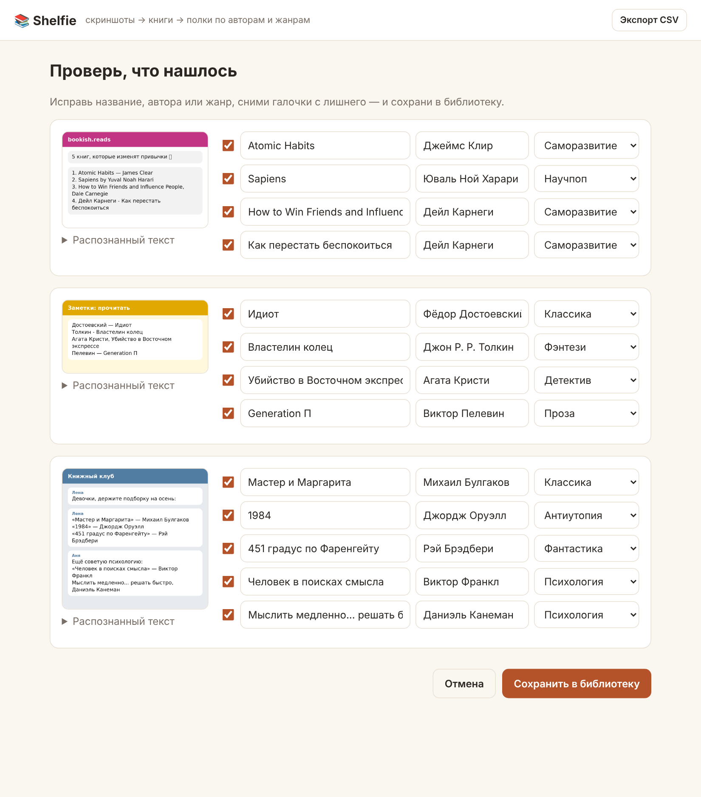
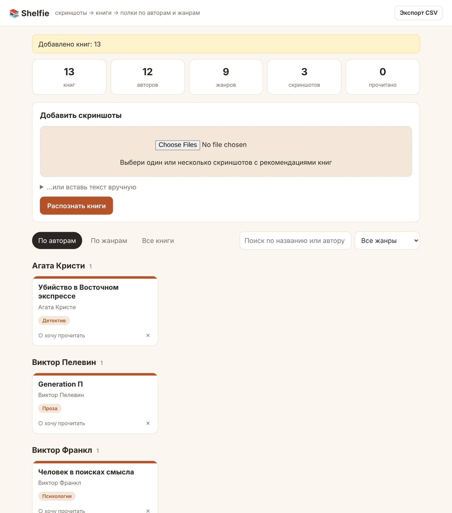
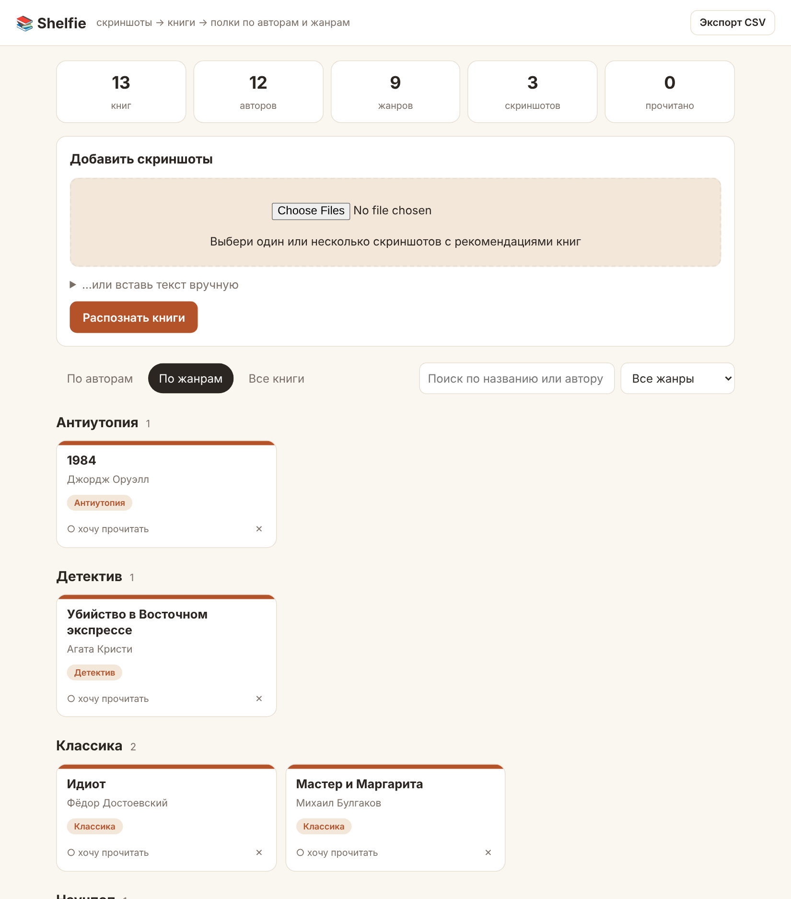
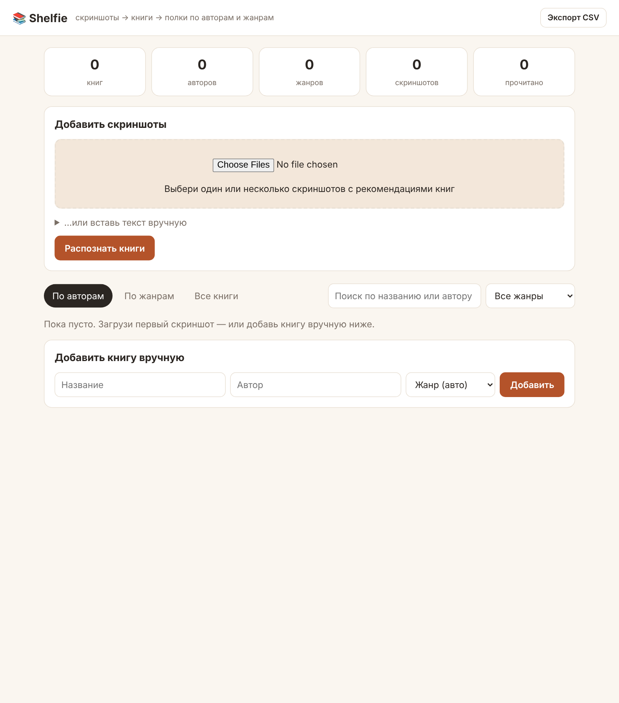

# 📚 Shelfie

Загружаешь скриншоты с рекомендациями книг — получаешь библиотеку, разложенную **по авторам и жанрам**.

> Учебный финальный проект. Идея: я много читаю и делаю скриншоты рекомендаций (чаты, посты, заметки). Они теряются в галерее. Shelfie собирает их в одном месте. От трекеров чтения вроде Bookmory и Leero отличается входом: книги добавляются **скриншотом**, а не поиском и штрихкодом.

Полное описание проекта: [PROJECT.md](PROJECT.md) · План разработки: [PLAN.md](PLAN.md)

## Как это работает

1. **Загрузка** одного или нескольких скриншотов (или вставка текста).
2. **OCR** (Tesseract, русский + английский) достаёт текст.
3. **Парсер** находит пары «название — автор», склеивает варианты имён («Оруэлл» → «Джордж Оруэлл»), подсказывает жанр.
4. **Проверка:** правишь название, автора, жанр, снимаешь лишние галочки.
5. **Библиотека:** по авторам, по жанрам, списком; поиск, «прочитано», экспорт CSV.

## Пользовательский сценарий

Увидела подборку в канале → сделала скриншот → открыла Shelfie и загрузила несколько скриншотов сразу → проверила найденное → сохранила → в разделе «Психология» увидела всё, что собрала.

## Скриншоты

**Экран проверки: три скриншота распознаны, найдено 13 книг**


**Библиотека по авторам**


**Библиотека по жанрам**


<details><summary>Пустая библиотека</summary>


</details>

Примеры входных данных (`samples/`) нарисованы скриптом, это не чужие посты.

## Запуск локально

Нужны Python 3.10+ и [Tesseract](https://github.com/tesseract-ocr/tesseract) с языками `rus` и `eng`.

```bash
# Ubuntu/Debian: sudo apt install tesseract-ocr tesseract-ocr-rus
# macOS:         brew install tesseract tesseract-lang
git clone https://github.com/elpys-ai/bookshot.git && cd bookshot
python -m venv .venv && source .venv/bin/activate
pip install -r requirements.txt
python app.py          # → http://127.0.0.1:5000
```

Попробуй загрузить файлы из папки `samples/`. Без Tesseract приложение тоже работает: текст можно вставить вручную.

## Тесты

```bash
python -m pytest -q    # 24 теста: парсер, переносы строк, весь поток приложения
```

Скриншоты для README пересоздаются командой `python scripts/take_screenshots.py` (нужен Playwright и Chrome).

## Структура

```
app.py              Flask: маршруты, SQLite
bookparser.py       разбор текста в книги
ocr.py              обёртка над Tesseract
genres.py           жанры и справочник известных авторов
templates/ static/  интерфейс
samples/            учебные скриншоты
tests/              pytest
scripts/            генерация примеров и скриншотов
.claude/skills/     скилл shelfie-curator для Claude
PROJECT.md PLAN.md  описание и план
```

## Скилл для Claude

В репозитории лежит скилл [`shelfie-curator`](.claude/skills/shelfie-curator/SKILL.md). Он учит Claude разбирать скриншоты с книгами в таблицу «название / автор / жанр», группировать по авторам и жанрам и при необходимости добавлять их в библиотеку. Claude Code подхватывает его автоматически при работе в этой папке.

## Работа с другими ИИ-агентами

Правила проекта лежат в [AGENTS.md](AGENTS.md) (его читает Codex) и в `CLAUDE.md` (Claude Code). Инструкцию скилла можно отдать любому агенту как обычный текстовый файл.

## Что дальше

- Open Library / Google Books API: обложки, год, точные жанры
- PWA и «Поделиться → Shelfie» прямо из галереи телефона
- Vision-LLM вместо правил для сложных скриншотов
- Свои полки, аккаунты, синхронизация

## Лицензия

MIT
